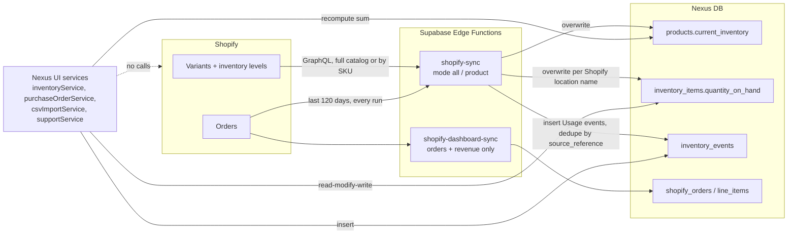
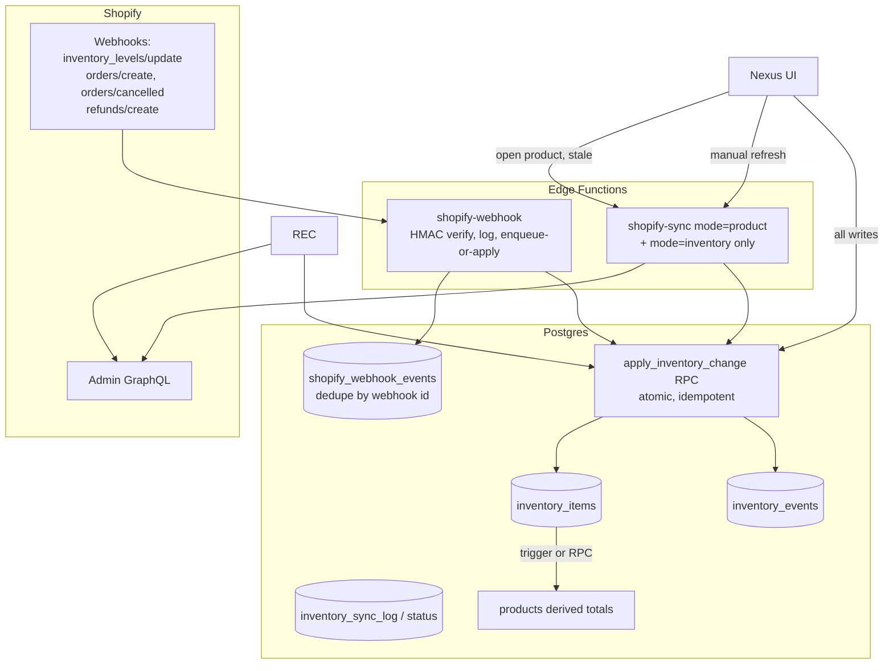

# Shopify Inventory Sync Improvement Plan

Status: proposal. Nothing in this document has been applied to the database or to Shopify.
Scope: audit of `src/` services, pages, migrations, and both Supabase Edge Functions as of 2026-09-21.

> Note: `supabase/functions/shopify-sync/index.ts` was refactored earlier in this session to batch its Supabase queries (CPU-limit fix). That change preserves behaviour and is **not yet deployed or run**. Findings below describe behaviour that is identical before and after that refactor unless stated.

## Decisions (confirmed by the owner, supersede anything below that conflicts)

1. **Nexus never writes to Shopify. Read-only, permanently.** All "phase 3 / write-back / push / outbox" material below is **out of scope**. Shopify quantities at Shopify-managed locations can only be changed in Shopify; Nexus mirrors them.
2. **No scheduled jobs (no cron / `pg_cron`).** Shopify is checked **on demand**: the first time a Shopify-linked product is involved in an action during a browser session, that one product is checked and the result is remembered for the session. Repeat actions in the same session reuse it. A manual "Refresh from Shopify" forces a check. Webhooks remain an optional, event-driven (not time-driven) addition for products nobody opens.
3. A Shopify sale lowers overall Nexus inventory exactly once, through the mirrored Shopify-location quantity. Nexus never subtracts the order line again.
4. **All stock is currently in Shopify, including wholesale.** The stored general count is `inventory_available` = Shopify count − units held (`inventory_allocated`). Wholesale fulfilment of a Shopify-linked product keeps the hold and logs the shipment (reservation status "Awaiting Shopify") until someone lowers the Shopify count and presses "Shopify updated". Manufacturer receipts for Shopify-linked products are logged only; the units appear after they are added in Shopify.

**Implemented (Phase 0, no schema change):** `supportService.saveProduct` no longer writes stock columns; `shopify-sync` recomputes `inventory_available`; `inventoryService.fulfillProducts`, `purchaseOrderService.fulfill` / `confirmShopifyAdjusted` / `receiveInventory` and the PO detail + receive screens follow decision 4. Not yet deployed or exercised in a browser.

## Production audit results (read-only queries, 2026-09-21)

| Check | Result | Meaning |
|---|---|---|
| `current_inventory` vs sum of location rows | 0 mismatches | No drift today. Nexus-side flows (C1-C3) are latent risks, not yet hit. |
| Inventory events | 1,864 total, **all** `Usage` from Shopify; zero manual, PO-received, transfer or conversion events | Nexus manual adjustments / PO receiving have never been used in production. The sync is the only writer. |
| Duplicate `(source_system, source_reference)` events | 0 | Safe to re-add the unique index later without cleanup. |
| Duplicate location names | 0 | Safe to add `locations.name` unique. |
| Negative `quantity_on_hand` | 7 rows, all at "SickFit", min −8, all products with generated `SHOPIFY-<id>` SKUs | Shopify allows negative (oversold) stock, so **do not add a `>= 0` constraint**. The generated SKUs mean real SKUs are missing in Shopify for those variants. |
| Locations with stock | "SickFit" (459 rows, main Shopify location); 2 "… via Shopify Collective" (partner-fulfilled, 26 rows); "Austin Clinic" (2 rows, 100 units, Nexus-owned) | Shopify Collective locations are mirror-only. Austin Clinic is the only non-Shopify stock. |
| Sync freshness | 485 of 496 products Shopify-linked; oldest last sync 2026-05-19, newest 2026-09-21 | Some products have gone four months without a refresh, which supports the on-demand check. |

---

## 1. Current Architecture

### Data model (relevant parts)

- `products` holds a single denormalised total: `current_inventory`, plus `inventory_allocated` and `inventory_available` (= current − allocated). Shopify link fields: `shopify_product_id`, `shopify_variant_id`, `shopify_handle`, `is_shopify_synced`, `last_shopify_sync_at`.
- `inventory_items` holds per-location stock: `quantity_on_hand`, unique on `(product_id, location_id)`.
- `locations` is keyed only by name. Shopify locations are matched **by name** (`ensureLocations` in the sync function). There is no stored Shopify location id.
- `inventory_events` is an append-style ledger (`event_type` is free text, `quantity_change`, `location_id`, `related_po_id`, `source_system`, `source_reference`).
- `inventory_reservations` (migration 019) tracks PO reservations. `shopify_orders` / `shopify_order_line_items` (migration 009) hold order/financial data for the dashboard.
- `parent_product_id` / `variant_title` (migration 014) model **style → variant** (e.g. different pack options of one style). It is not a conversion or bundle model. `no_bundles` is only a boolean flag and `pack_quantity` / `pack_unit` are descriptive. **No table or code models converting one SKU into another.**
- There are no database triggers or functions that touch inventory (only `set_updated_at` triggers). All inventory arithmetic happens in browser-side TypeScript.
- RLS on inventory tables is `using (true) with check (true)` (migration 002 and later): anyone holding the anon key can read and write inventory.

### Flows



**Shopify → Nexus** ([shopify-sync/index.ts](../supabase/functions/shopify-sync/index.ts)). Triggered only by the two buttons in [ProductsPage.tsx](../src/pages/ProductsPage.tsx) (`syncAllProducts`, and per-row `syncProduct` at ~line 702) through [shopifyService.ts](../src/services/shopifyService.ts). It pulls variants with `inventoryLevels(first: 20)`, upserts `products`, sets `products.current_inventory` to the sum of Shopify "available", and overwrites `inventory_items.quantity_on_hand` for each Shopify location. It then fetches **all orders in the lookback window (default 120 days)** and inserts `Usage` events for line items it can match. There is no schedule, no webhook, no cron.

**Nexus → Shopify.** None. No mutation is ever sent to Shopify. Every Nexus-side inventory change on a Shopify-linked product is invisible to Shopify and is eventually overwritten by the next sync.

**Orders → inventory events.** Shopify orders create `Usage` events with `source_system = 'shopify'`, `source_reference = '<orderTail>:<lineTail>'`. They do **not** change `quantity_on_hand` (the sync overwrites quantity from Shopify, which already includes the sale). So the events are an analytics ledger, not the mechanism that moves stock. Duplicate protection is a select-then-insert in application code (see Risk C2/H5).

**Locations → inventory.** Shopify location names become Nexus `locations` rows (type "Shopify Fulfillment Location"). Nexus-only locations (manufacturer, warehouse, retailer) hold stock in `inventory_items` that Shopify knows nothing about.

**Inventory-changing paths inside Nexus** (complete list found):

| Path | File / function | Touches `current_inventory` | Touches `inventory_items` | Creates `inventory_events` |
|---|---|---|---|---|
| Manual adjustment | [inventoryService.ts](../src/services/inventoryService.ts) `createAdjustment` | via `syncProductInventory` (recompute) | read-modify-write | yes (before the item update) |
| Edit/create inventory row | `saveItem`, `removeItem` | via recompute | direct set / delete | no |
| Transfer between locations | `transferItem` | via recompute | 2 read-modify-writes | 2 events |
| PO receive | [purchaseOrderService.ts](../src/services/purchaseOrderService.ts) `receiveInventory` → `createAdjustment` | via recompute | yes | `PO Received` |
| PO fulfil (customer/lookbook PO) | `fulfill` → `inventoryService.fulfillProducts` | **direct write** | **not touched** | `Usage` |
| Allocation / release | `allocateProducts`, `releaseProducts` | no (`inventory_allocated`) | no | no |
| CSV PO import with received qty | [csvImportService.ts](../src/services/csvImportService.ts) ~L385-452 | via own recompute | read-modify-write | `PO Received` |
| Create product with starting stock | [supportService.ts](../src/services/supportService.ts) `saveProduct` | direct | upsert default location | no |
| Edit product form / "ignore" toggle | `supportService.saveProduct` (called with `{...row}`) | **writes whatever value the form/row held** | no | no |
| Shopify sync | `shopify-sync` | direct (`= Shopify total`) | overwrite per Shopify location | `Usage` from orders |
| Seed script | `src/db/scripts/seed-reorder-scenario.ts` | dev only | dev only | dev only |

Returns and cancellations have **no inventory handling** anywhere in Nexus. Cancelling a PO releases reservations only. Shopify refunds/returns/cancellations are not processed (cancelled orders are merely skipped at import time).

---

## 2. Current Problems / Risks

### Critical

**C1. `fulfillProducts` drifts `current_inventory` away from `inventory_items`, and is not idempotent.**
`inventoryService.fulfillProducts` (invoked by `purchaseOrderService.fulfill`) decrements `products.current_inventory` and inserts a `Usage` event, but never decrements any `inventory_items` row. The next call to `syncProductInventory` (any adjustment, transfer, receive, CSV import, inventory edit) recomputes `current_inventory` from `inventory_items` and silently restores the fulfilled units. `fulfill` also has no status guard, so calling it twice deducts twice. The `Math.max(..., 0)` clamp hides oversells instead of surfacing them.

**C2. Two competing definitions of `current_inventory`.**
`shopify-sync` sets `current_inventory` to the sum of **Shopify** locations only. `syncProductInventory` (and the CSV path) set it to the sum of **all** `inventory_items`, including Nexus-only locations. For any product with stock outside Shopify, the value flips depending on which code ran last. Also, `shopify-sync` does not recompute `inventory_available`, so available-to-sell stays stale until some other flow runs.

**C3. Nexus edits on Shopify-linked products are overwritten and Shopify is never told.**
Manual adjustment, PO receive, transfer or CSV import at a Shopify location changes only Nexus. The next sync (manual button, no schedule) replaces `quantity_on_hand` with Shopify's number. Received manufacturing stock can vanish from Nexus, or Shopify keeps selling from a stale count.

### High

**H1. Stale form writes overwrite newer inventory.** `ProductsPage` calls `supportService.saveProduct({ ...row, ignored: !row.ignored })`, and the product edit form does the same. `saveProduct` upserts `current_inventory: productPayload.current_inventory` from the loaded row. Any sync or adjustment since the page loaded is reverted, including Shopify values just synced.

**H2. No atomicity or concurrency control on adjustments.** `createAdjustment`, `transferItem`, `receiveInventory` and the CSV import do read → compute in browser → write. Two concurrent users (or a sync mid-flight) produce lost updates. `createAdjustment` inserts the event **before** updating the item, so a failed update leaves an event with no quantity change; it also throws (`.single()`) if no inventory row exists for that location.

**H3. PO receiving is not idempotent and mishandles partials.** `receiveInventory` only checks the PO status at the start and always finishes with status `Received`, even though `Partially Received` exists. A double-click or retry adds stock twice. The event uses the full `quantityToReceive` while `po_line_items.quantity_received` is clamped to `quantity_ordered`, so over-receipts inflate stock but not the line.

**H4. Product-mode sync is as expensive as a full sync for orders.** `mode: "product"` fetches variants for one SKU, but still pages through **every order in the last 120 days** and filters afterwards (`syncShopifyOrderUsageEvents` `skuFilter`). This is a major contributor to the CPU-limit failures and makes a "lightweight per-product check" impossible today. Orders older than 60 days may also require the `read_all_orders` scope (unverified).

**H5. Usage-event dedupe is only application-level.** Migration 008 dropped the unique index on `(source_system, source_reference)` and replaced it with a non-unique index. Idempotency now relies on select-then-insert. Two overlapping syncs (double click, retry, future webhook + sync) can both pass the check and both insert.

**H6. Endpoints and tables are open.** All inventory tables have `using (true)` RLS policies. No `supabase/config.toml` exists in the repo, so function JWT verification settings are unknown; both Edge Functions send `Access-Control-Allow-Origin: *`. Anyone with the anon key can write inventory and trigger expensive Shopify syncs. Any future webhook endpoint must use HMAC verification instead of JWT.

### Medium

- **M1. Shopify usage events never reverse.** Cancelled/refunded orders are skipped only if already cancelled at import time. An order imported and later cancelled or refunded leaves a permanent `Usage` event. Refunds/returns are not modelled at all.
- **M2. Location matching by name.** Renaming a Shopify location creates a duplicate Nexus location and orphans the old `inventory_items` row (stale stock stays counted). `locations.name` has no unique constraint. Inventory levels are read with `first: 20` and no pagination.
- **M3. Deleted or unpublished Shopify variants are never detected.** Sync only upserts; nothing marks a product as no longer in Shopify, and the stale `quantity_on_hand` remains.
- **M4. SKU-based fallbacks.** Missing SKU generates `SHOPIFY-<id>`; duplicate SKU generates `<sku>--<id>`. Orders are matched by variant id first, then SKU, so a renamed SKU can silently attribute usage to the wrong product. A manual product whose SKU matches an unlinked Shopify variant is *not* linked; a suffixed duplicate is created instead.
- **M5. Two functions fetch orders independently** (`shopify-sync` and `shopify-dashboard-sync`) with the same query, doubling API and CPU cost.
- **M6. `transferItem`** does 4-5 non-atomic writes and is unaware of Shopify locations (transferring out of a Shopify location changes only Nexus).

### Low

- **L1.** `getVariantDisplayLabel` in `shopify-sync` is unused.
- **L2.** Free-text `event_type` allows drift in spelling (`Usage`, `PO Received`, `Transfer In/Out`); no check constraint.
- **L3.** `last_shopify_sync_at` is set only on sync success and there is no per-product sync status/error field for the UI.
- **L4.** Product detail page shows Shopify links only and no freshness indication.

---

## 3. Source of Truth Recommendation

**Hybrid, decided per location, with Shopify authoritative for stock it sells and Nexus authoritative for everything else.**

| Data | Authority | Why |
|---|---|---|
| Quantity at a **Shopify-managed location** (mapped to a Shopify location id) | **Shopify** | Every DTC sale, refund and fulfilment reduces it there in real time. Nexus cannot see those changes without a feed. Nexus holds a *mirror*. |
| Quantity at **non-Shopify locations** (manufacturer, warehouse, retailer, in-transit) | **Nexus** | Shopify has no knowledge of them. |
| Reservations / allocations, safety stock, reorder points, PO state, planning | **Nexus** | Shopify has no equivalent. |
| Stock moving *into* a Shopify location (PO received into it, transfer in) | **Shopify** (the change is made in Shopify; Nexus picks it up on the next check). | Nexus is read-only toward Shopify. To avoid the sync erasing a receipt, Nexus should receive manufacturer stock into a **Nexus-owned location** (e.g. Warehouse) and the physical move to the Shopify location is then done in Shopify. |
| Product-level `current_inventory` | **Derived, never written directly**: sum of `inventory_items` (all locations). | Removes C2; one definition everywhere. |

Rules that make this safe:

1. **Mirror rows are read-only in Nexus** for any location with a `shopify_location_id`. Direct edits, adjustments and transfers on those rows are blocked with a "change this in Shopify" message. This is the main protection against Nexus and Shopify disagreeing.
2. **No writes to Shopify at all.** This removes sync loops by construction; the only remaining loop risk is Nexus events being re-applied to a mirror, handled by rule 5.
3. **Every applied change carries its origin** (`source_system`, `source_reference`). Applying the same source reference twice is a no-op.
4. **Staleness is decided by Shopify's own `updated_at`** for the inventory level, not by local wall clock, so an older payload never overwrites a newer value.
5. **Ledger vs. mirror.** For Shopify locations, `inventory_events` are informational (`Usage` from orders) and must never be applied to `quantity_on_hand` a second time. Introduce an explicit `affects_quantity` flag (Section 9) instead of inferring from `source_system`.

Rollout: fix Nexus-side drift first (phase 0), then the read-only mirror with on-demand checks (phases 1-2). There is no write-back phase.

---

## 4. Inventory Change Matrix

| Action | Nexus Inventory Changes? | Shopify Inventory Changes? | Shopify Check Needed? | Notes |
|---|---|---|---|---|
| Shopify customer order | Mirror decreases via webhook / next sync; `Usage` event (informational, `affects_quantity = false`) | Yes (by Shopify) | No, arrives via `inventory_levels/update` + `orders/create` | Never subtract the order line again in Nexus. |
| Nexus manual adjustment at a **non-Shopify** location | Yes | No | No | Uses atomic RPC (task list). |
| Nexus manual adjustment at a **Shopify** location | Blocked ("make this change in Shopify") | No | Yes, session check of that product | Avoids the current overwrite (C3). |
| Receive manufacturer PO into non-Shopify location | Yes | No | No | |
| Receive manufacturer PO into a Shopify location | Not allowed; receive into a Nexus-owned location instead | No (done manually in Shopify later) | Yes, session check of that product | Idempotent on receipt id (H3). |
| Product conversion (2-pair → 2 × 1-pair) | Yes at Nexus-owned locations: −1 source, +2 targets, one linked event group | No | Check each affected Shopify SKU | See Section 8. No model exists today. |
| Retail/customer (wholesale) order: allocate | `inventory_allocated` only | No | No | Wholesale does not reduce Shopify DTC availability unless the same location is shared; decide per location. |
| Retail/customer order: fulfil | Yes (fix C1: decrement a chosen location's `inventory_items`) | No | Yes for Shopify locations (session check) | Guard with status + idempotency key. |
| Shopify return / refund with restock | Mirror increases via `inventory_levels/update`; reverse `Usage` event | Yes (by Shopify) | Via webhook `refunds/create` | Not handled today (M1). |
| Order cancellation (Shopify) | Mirror via webhook; reverse `Usage` event | Yes (by Shopify) | Via `orders/cancelled` | |
| Cancellation of a Nexus PO | Release reservation | No | No | |
| Product page opened | No | No | **Yes, once per session per product**: lightweight single-product check the first time it is opened; reused for the rest of the session | Read-only. See Section 6. |
| Manual "Refresh from Shopify" | Mirror overwritten for that product | No | Yes | Same code path as the stale check but forced. |
| Manual "Sync All" (user-triggered only, no schedule) | Corrects drift; writes discrepancy rows | No | Yes, whole catalog | Explicit action; the only whole-catalog path. |
| CSV import with received qty | Yes | No | Same as PO receive | Currently writes events before item (H2). |
| Create product with starting inventory | Yes, default location | No | No | Not Shopify-linked at creation. |

---

## 5. Proposed Architecture



Key design points:

1. **One write path.** All quantity changes (UI actions, sync, webhooks, reconciliation) go through a Postgres function `apply_inventory_change(...)` that, inside one transaction: locks the `inventory_items` row (`for update`), checks the idempotency key, applies the delta or mirror value, inserts the event, and recomputes `products.current_inventory` / `inventory_available`. This removes C1, C2, H2 and H3 in one place and makes them impossible to reintroduce from the browser.
2. **Mirror updates carry Shopify's `updated_at`.** The function ignores a mirror update older than `inventory_items.shopify_updated_at`.
3. **Targeted, on-demand checks first** (Section 6); **webhooks optional** (Section 7) for products nobody opens; **no schedule and no write-back**.
4. **`shopify-sync` stays** as the manual catalog sync and continues to work unchanged for callers (same request/response shape); its inventory write is redirected to the RPC once that exists.
5. **Status is stored, not inferred.** `inventory_items` / `products` gain sync status fields so the UI can show state without calling Shopify (Section 11).

---

## 6. Product-Level Sync Strategy

Query a **single product** (by `shopify_variant_id`, falling back to SKU) instead of the catalog when:

- A Shopify-linked product is involved in any action (opened, adjusted, received against, converted, fulfilled) and it has **not already been checked in this browser session**. The session cache is an in-memory map `productId → checkedAt` (cleared on reload or logout); repeat actions reuse it, and it never expires on a timer. The status chip shows "Last checked X minutes ago" so users can see the age.
- The user presses "Refresh from Shopify".
- Before any Nexus action on a product that has stock at a Shopify location, even if already checked this session, when the action is a fulfil or receive (the moments where a stale number causes real harm). Other actions reuse the session result.
- A webhook arrives for an unknown inventory item id (resolve just that item).

Use the whole-catalog path only for: first-time linking, and the manual "Sync All".

Implementation notes:

- Add a lean `mode: "inventory"` to `shopify-sync`: query `node(id: variantId) { ... on ProductVariant { inventoryItem { inventoryLevels { ... } } } }` (or `productVariants(query: "sku:...")`) and return only quantities. **Do not fetch orders** in this mode (fixes H4).
- For `mode: "product"`, replace the full-window order fetch with an orders query filtered by SKU (`sku:<value>`) and a short window, or skip order import entirely and let webhooks / "Sync All" own usage events.
- Debounce and dedupe in the client: one in-flight check per product, and reuse the result across components.
- Rate limits: Shopify GraphQL cost is calculated per query. Single-variant checks are tiny; keep `inventoryLevels(first: 20)` and add pagination only when a shop has more than 20 locations.

---

## 7. Shopify Webhook Strategy

Only subscribe to what closes a real gap. Webhooks are at-least-once and unordered; every handler must be idempotent and treat Shopify's `updated_at` as the ordering key. Verify `X-Shopify-Hmac-Sha256` against the raw body; the function must be deployed without Supabase JWT verification, so HMAC is the only auth. Store `X-Shopify-Webhook-Id` and drop repeats.

| Topic | Use it? | Handler behaviour |
|---|---|---|
| `inventory_levels/update` | **Yes, primary.** | Payload gives `inventory_item_id`, `location_id`, `available`, `updated_at`. Map to product/location (needs the stored Shopify ids from Section 9), apply mirror update if newer than stored `shopify_updated_at`. If the item is unknown, do a single-product lookup. |
| `orders/create` | **Yes.** | Insert `Usage` event (informational) using the existing `source_reference` format so it stays idempotent with the batch importer. Does not change quantity. |
| `orders/cancelled` | **Yes.** | Insert a reversing informational event (`source_reference` suffixed `:cancel`). Quantity correction arrives via `inventory_levels/update`. |
| `refunds/create` | **Yes, if returns matter to reporting.** | Reversing informational event for restocked lines only. |
| `products/delete` | **Yes, small.** | Mark the Nexus product `shopify_status = 'deleted'`; do not delete rows or zero stock. |
| `products/update` | **No** (initially). | Very noisy; title/price changes are not inventory. Catalog sync covers it. |
| `orders/updated`, `orders/paid`, `orders/fulfilled` | **No.** | Inventory availability already changes at order creation in Shopify; these add duplicates without new information. |
| `inventory_items/*`, `locations/*` | **Optional later.** | `locations/update` only if location renames cause real problems (M2); the stored location id already fixes the underlying issue. |

Register via `webhookSubscriptionCreate` from a one-off script (not from the browser). Webhooks are optional under the on-demand model: without them, a product nobody touches simply shows an older "last checked" until someone opens it or runs Sync All. Add them only if that staleness matters for reporting (e.g. dashboards reading `current_inventory` directly). Registering a subscription is a write to Shopify configuration (not inventory); it needs your explicit go-ahead.

---

## 8. Product Conversion Considerations

Current model: **there is no conversion model.** `parent_product_id` links style variants, `pack_quantity`/`pack_unit` describe a pack, and `no_bundles` is a flag. A 2-pair SKU and a 1-pair SKU are two independent `products` rows with independent stock. Bundles (a sellable that contains other SKUs) and conversions (a physical act that consumes one SKU and produces others) are different concepts and both are missing.

Recommended model, kept minimal:

- A **conversion is a stock transaction, not a product relationship.** Record it as one grouped set of `inventory_events` sharing a `conversion_id`: `Conversion Out` (−1 × 2-pair SKU) and `Conversion In` (+2 × 1-pair SKU), all at the same location, applied in one `apply_inventory_change` transaction. Stock is conserved by construction (no fake stock: the "in" quantity is derived from a declared ratio, and the "out" cannot exceed on-hand).
- Optional `product_conversion_rules(source_product_id, target_product_id, ratio_out, ratio_in)` to pre-fill and validate the action. Not required for phase 1.
- **Shopify interaction:** convert only at locations where the user has decided which system leads.
  - Non-Shopify location: no Shopify effect.
  - Shopify location: Nexus blocks the conversion there. It must be performed in Shopify (−1 on one variant, +2 on another) and Nexus picks up both changes on the next check. Nexus never sends the adjustment.
- **Do not derive "effective inventory" of one SKU from another** in the mirror. Availability-based bundles (a 2-pair listing whose sellable quantity depends on 1-pair stock) should be modelled separately as a *bundle*, and Shopify already supports that natively; do not emulate it in Nexus until it is needed.

---

## 9. Database Changes

None of these have been applied. All are additive; apply in a staging project first.

**New columns**

- `locations.shopify_location_id text unique null` (numeric/gid). Replaces name matching. Backfill by name once, then sync by id.
- `products.shopify_inventory_item_id text` + index. Needed to resolve `inventory_levels/update` webhooks.
- `products.shopify_status text` (`active` / `archived` / `deleted` / `not_linked`), `products.shopify_last_error text`, `products.shopify_last_checked_at timestamptz` (checked, distinct from `last_shopify_sync_at` = changed/applied).
- `inventory_items.shopify_updated_at timestamptz` (Shopify's own timestamp for the level), `inventory_items.source text default 'nexus'` (`shopify_mirror` for mirrored rows).
- `inventory_events.affects_quantity boolean not null default true` (set `false` for Shopify order usage events), `inventory_events.idempotency_key text`, `inventory_events.conversion_id uuid null`.

**Constraints and indexes**

- Restore uniqueness for event dedupe as a **partial unique index** on `inventory_events(source_system, source_reference) where source_system is not null and source_reference is not null`. Migration 008 removed the original; first run a duplicate check (`group by ... having count(*) > 1`) and clean duplicates before re-adding. Use `insert ... on conflict do nothing` in the importer afterwards.
- `unique(idempotency_key)` where not null.
- `locations.name` unique (after checking for existing duplicates).
- No `quantity_on_hand >= 0` constraint: production has 7 legitimately negative (oversold) Shopify rows.

**New tables**

- `shopify_webhook_events(webhook_id pk, topic, shopify_updated_at, received_at, processed_at, status, error)`; for HMAC-verified dedupe and observability.
- `inventory_discrepancies(product_id, location_id, nexus_qty, shopify_qty, detected_at, resolved_at)`; written whenever a check finds Nexus's mirror different from Shopify; feeds the "differs from Shopify" UI state.

**Functions**

- `apply_inventory_change(product_id, location_id, delta, absolute, event_type, idempotency_key, source_system, source_reference, shopify_updated_at, affects_quantity, ...)`: single transactional write path (lock, idempotency, event, item update, product recompute).
- `recompute_product_inventory(product_id)`: one definition of `current_inventory` and `inventory_available`, called only by the function above.

**RLS.** Tightening the `using (true)` policies is out of scope here but is a prerequisite for trusting client-side inventory writes long-term. At minimum, revoke direct `update` on `inventory_items.quantity_on_hand` and `products.current_inventory` from `anon` once the RPC exists, so the RPC is the only path.

---

## 10. Backend Changes

| File / function | Change |
|---|---|
| [shopify-sync/index.ts](../supabase/functions/shopify-sync/index.ts) `syncProductsAndInventory` | Already batched (this session). Write quantities via RPC; stop setting `current_inventory` directly; recompute `inventory_available`; use `shopify_location_id`; store `shopify_inventory_item_id`. |
| same, `mode` handling | Add `mode: "inventory"` (variant/inventory only, no orders). In `mode: "product"`, filter orders by SKU or skip them. |
| same, `syncShopifyOrderUsageEvents` | `insert ... on conflict do nothing` after unique index; set `affects_quantity = false`. |
| [shopify-dashboard-sync/index.ts](../supabase/functions/shopify-dashboard-sync/index.ts) | Share order fetching with `shopify-sync` or stagger; avoid duplicate 120-day pulls (M5). |
| New `shopify-webhook` edge function | HMAC verify, dedupe by webhook id, route by topic (Section 7). Deployed with JWT verification off. |
| [inventoryService.ts](../src/services/inventoryService.ts) `createAdjustment`, `transferItem`, `saveItem`, `removeItem`, `fulfillProducts` | Route through the RPC. `fulfillProducts` must pick a location, decrement `inventory_items`, be idempotent per PO, and stop clamping silently. Remove local `syncProductInventory`. |
| [purchaseOrderService.ts](../src/services/purchaseOrderService.ts) `receiveInventory`, `fulfill` | Idempotency key per receipt/fulfil; honour partial receipt (`Partially Received`); clamp events to what is applied to the line; guard against re-fulfil. |
| [csvImportService.ts](../src/services/csvImportService.ts) (~L385-452, `syncProductInventoryFromItems`) | Use the RPC; keep import-link undo data. |
| [supportService.ts](../src/services/supportService.ts) `saveProduct` | Never write `current_inventory` on update (H1); create-with-starting-stock goes through the RPC. |
| [shopifyService.ts](../src/services/shopifyService.ts) | Add `refreshProductInventory(productId, { force })`, with in-flight dedupe and freshness check. |

---

## 11. Frontend Changes

Plain-language states shown per Shopify-linked product and on inventory rows for Shopify locations:

| State | Meaning | Shown when |
|---|---|---|
| **Synced** (green) | Matches Shopify as of the last check | Checked this session, no discrepancy |
| **Checking Shopify…** | A refresh is in flight | Product opened while stale / refresh pressed |
| **Last checked 12 min ago** | Age of last successful check | Always shown as secondary text |
| **Differs from Shopify** (amber) | Nexus and Shopify quantities disagree; show both numbers and a "Use Shopify's number" action | Open row in `inventory_discrepancies` |
| **Sync failed** (red) | Last attempt errored; shows short reason and Retry | `shopify_last_error` set |
| **Not connected to Shopify** (neutral) | No Shopify link | `shopify_variant_id` null |

Other changes:

- [ProductDetailPage.tsx](../src/pages/ProductDetailPage.tsx): add the status chip and an automatic single-product check when stale (currently it only shows links).
- [ProductsPage.tsx](../src/pages/ProductsPage.tsx): rename per-row "Sync" to "Refresh from Shopify" (calls the lightweight mode); keep "Sync All" as an explicit catalog action with a confirmation and progress feedback; stop showing "recent usage events" counts as the success message for a quantity check.
- [InventoryPage.tsx](../src/pages/InventoryPage.tsx): mark mirror rows as "Managed by Shopify" and disable direct edit/adjust with an explanation ("Change this in Shopify, or use Receive Inventory"). Show a "Shopify" badge per location.
- Hide Shopify ids everywhere except a collapsed "Technical details" section.
- Adjustment and receive dialogs: show the location's authority and the fresh pre-check result ("Shopify currently shows 42").

---

## 12. Failure & Edge Cases

| Case | Behaviour |
|---|---|
| Shopify unavailable / network failure | Keep last known quantities, set `shopify_last_error`, show "Sync failed" with Retry; never zero out stock. Retry with exponential backoff in the client; the next action on the product tries again. |
| Rate limits (429 / `THROTTLED`) | Respect `Retry-After` and `extensions.cost.throttleStatus`; page slower; "Sync All" is resumable by cursor. Per-product checks are cheap and unaffected. |
| Missing SKU | Link by variant id; keep the generated fallback SKU but flag the product in the UI so someone assigns a real SKU. |
| Duplicate SKU | Existing suffix strategy stays; surface a warning listing both variants. Do not auto-merge. |
| Deleted Shopify variant | Detect when a check or Sync All no longer returns the variant (and via `products/delete` if webhooks are added); mark `shopify_status = 'deleted'`, freeze the mirror at last value, exclude from "differs" alerts; never delete Nexus rows or history. |
| Multiple Shopify locations | Keyed by `shopify_location_id`. Unmapped/new locations are auto-created but flagged for review. Inventory levels beyond 20 need pagination. |
| Concurrent inventory changes | Row lock in the RPC; mirror updates guarded by `shopify_updated_at`; writes to Shopify use compare-and-set. |
| Inventory changed while sync is running | Sync reads Shopify state, then applies through the RPC with the level's `updated_at`; a newer webhook/edit wins and the older payload is discarded. |
| Cancelled orders | Informational reversing event; quantity follows Shopify. Orders cancelled after import currently leave a permanent Usage event (M1). |
| Refunded orders / returns | Reverse only restocked lines; do not reverse non-restocked refunds. |
| Partial fulfilment | Shopify decrements available at order creation regardless of fulfilment; Nexus must not deduct again on fulfilment webhooks (we do not subscribe to them). Wholesale partial fulfil in Nexus should apply only the shipped quantity. |
| Webhook out of order / duplicate | Dedupe by webhook id; ignore older `updated_at`. |
| Product never checked recently | Shown with its real "last checked" age; the next action on it triggers a check. |
| Nexus and Shopify disagree on a non-mirror location | Not applicable: Nexus owns it. |

---

## 13. Implementation Tasks

Ordered by dependency; sized so the whole list is roughly a working week. There is no write-back phase.

**Day 0: verify what is already changed**
- [ ] Deploy the batched `shopify-sync` to a staging Supabase project; run "Sync All" and one per-product sync; compare response counts with the previous version and check CPU time in function logs.
- [ ] Run the read-only audit queries in Section 14 against production (or paste results) to find negative stock, duplicate usage events, `current_inventory` vs summed items drift, and duplicate location names.

**Phase 0: safe fixes, no schema change**
- [ ] `shopify-sync`: in `mode: "product"`, skip the 120-day order pull (or filter by SKU) so per-product refresh is genuinely lightweight.
- [ ] `shopify-sync`: also set `inventory_available` when writing `current_inventory`.
- [ ] `supportService.saveProduct`: stop writing `current_inventory`/`inventory_available` on edit (H1).
- [ ] `inventoryService.fulfillProducts` + `purchaseOrderService.fulfill`: decrement `inventory_items` at the PO location, guard against re-fulfil by status (C1).
- [ ] `purchaseOrderService.receiveInventory`: guard double-submit, set `Partially Received` when applicable, apply the same clamped quantity to event and line (H3).

**Phase 1: foundation (DB)**
- [ ] Migration: `locations.shopify_location_id`, `products.shopify_inventory_item_id`, `shopify_status`, `shopify_last_checked_at`, `shopify_last_error`, `inventory_items.shopify_updated_at` / `source`, `inventory_events.affects_quantity` / `idempotency_key` / `conversion_id`. Apply to staging first.
- [ ] Data cleanup script (read-only report first): duplicate `(source_system, source_reference)` events, duplicate location names.
- [ ] Migration: partial unique index on event source reference, unique idempotency key, unique `locations.name`.
- [ ] Postgres `apply_inventory_change` + `recompute_product_inventory`, with SQL tests.

**Phase 2: read path**
- [ ] `shopify-sync`: use location id, store inventory item id, write quantities via the RPC, set `affects_quantity = false` on order usage events, `on conflict do nothing`.
- [ ] `shopify-sync` `mode: "inventory"` lightweight single-variant query.
- [ ] `shopifyService.refreshProductInventory` with a per-session cache (`productId → checkedAt`) and in-flight dedupe.
- [ ] UI: status chip on product detail and inventory rows, auto-check on open when stale, rename per-row button.
- [ ] Route `createAdjustment`, `transferItem`, `saveItem`, `removeItem`, CSV import through the RPC; block direct edits on mirror rows in `InventoryPage`.

**Phase 2b: event-driven**
- [ ] `shopify-webhook` function (HMAC, dedupe table) with `inventory_levels/update`, `orders/create`, `orders/cancelled`, `refunds/create`, `products/delete`.
- [ ] One-off script to register webhook subscriptions (uses env secrets, never committed).
- [ ] `inventory_discrepancies` table written by checks / Sync All; "Differs from Shopify" UI with a "Use Shopify's number" action (applies the mirror value locally only).
- [ ] Reduce the duplicate order pull between `shopify-sync` and `shopify-dashboard-sync`.

**Later (Nexus-side only)**
- [ ] Conversion action with grouped events at Nexus-owned locations (Section 8).

**Hardening**
- [ ] Tighten RLS / revoke direct writes on inventory columns; set explicit `verify_jwt` in `supabase/config.toml`.

---

## 14. Testing Plan

**Unit**
- Pure helpers in `shopify-sync`: SKU resolution (missing, duplicate, renamed, unlinked manual product), `getInventoryCategoryFromAncillaryCategory`, weight formatting, chunking, anchor/child ordering.
- Session-cache logic (first touch checks, repeat touch reuses, forced refresh bypasses, fulfil/receive always re-check), state-to-label mapping for the UI chip.
- Webhook handler: HMAC valid/invalid, duplicate webhook id, older `updated_at`, unknown inventory item.
- Conversion validation: cannot convert more than on-hand; ratios conserve stock.

**Database (SQL / pgTAP or scripted against a staging project)**
- `apply_inventory_change`: idempotent on repeated key, concurrent calls serialise (two sessions), older `shopify_updated_at` ignored, product totals equal the sum of item rows, negative-stock behaviour.
- Unique index on event source reference rejects duplicates; importer with `on conflict do nothing` inserts once when run twice concurrently.
- Migration up/down on a copy of production data.

**Integration**
- Run `shopify-sync` twice against a dev store: no new duplicate SKUs/locations, counts stable, preserved fields (`safety_stock`, `vendor_id`, `reorder_point`, `target_stock`) unchanged.
- Multi-variant product: parent/child linkage and `variant_sort_order` unchanged versus the pre-refactor function.
- Webhook end-to-end with Shopify CLI/`webhook trigger` or replayed fixtures: order → mirror decrement + informational event, cancellation → reversing event.
- Reconciliation with an injected mismatch produces exactly one discrepancy.
- PO receive twice (double click) adds stock once; partial receive keeps status `Partially Received`.
- PO fulfil twice deducts once; fulfilment reduces the chosen location's `inventory_items`.

**Shopify sandbox / test store**
- Because Nexus only reads from Shopify, tests can run against the real store read-only. A development store is only needed if you want to test odd cases (no SKU, duplicate SKU, multiple locations) without touching real products.
- Required API scopes are read-only: `read_inventory`, `read_products`, `read_orders` (+ `read_all_orders` if the 120-day lookback must include orders older than 60 days). `write_inventory` is not needed and, if granted, can be removed.

**Manual UX**
- Open a Shopify-linked product: chip shows "Checking Shopify…" then "Synced · checked just now"; reopening it in the same session does not call Shopify again; a page reload does.
- Take Shopify offline (block the function): "Sync failed" with Retry, stock values unchanged.
- Change stock in Shopify, wait for webhook: value updates without any button.
- Create a deliberate mismatch: "Differs from Shopify" shows both numbers and the resolve action.
- Attempt to adjust a mirrored location: blocked with a clear explanation.
- Non-technical read-through: all labels understandable without seeing a Shopify id.

**Read-only audit queries to run first (no writes)**

```sql
-- current_inventory vs sum of location rows
select p.id, p.sku, p.current_inventory, coalesce(sum(i.quantity_on_hand),0) as items_total
from products p left join inventory_items i on i.product_id = p.id
group by p.id having p.current_inventory <> coalesce(sum(i.quantity_on_hand),0);

-- negative stock
select * from inventory_items where quantity_on_hand < 0;

-- duplicate Shopify usage events
select source_system, source_reference, count(*) from inventory_events
where source_system is not null group by 1,2 having count(*) > 1;

-- duplicate location names
select name, count(*) from locations group by name having count(*) > 1;

-- Shopify-linked products with no matching Shopify-type location rows / stale sync
select sku, last_shopify_sync_at from products
where is_shopify_synced order by last_shopify_sync_at nulls first limit 50;
```
